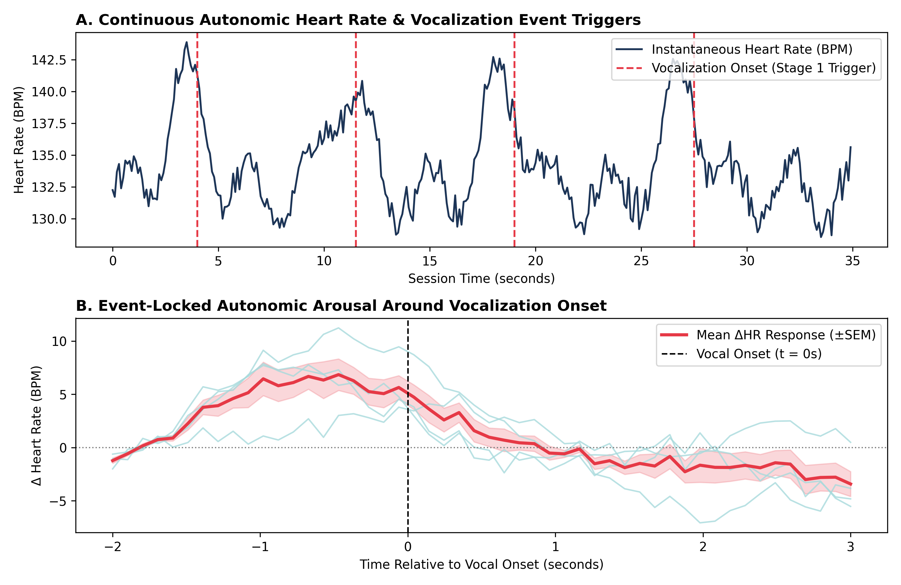

# Multi-Modal Vocalization Segmentation & Autonomic Heart-Rate Alignment

An open-source, two-stage Python pipeline for automated syllable segmentation, fundamental frequency ($F_0$) extraction, and event-locked alignment with continuous autonomic heart-rate (BPM) signals.

### Stage 1: Acoustic Segmentation & Pitch ($F_0$) Tracking

### Stage 2: Event-Locked Autonomic Heart-Rate Alignment

## Pipeline Architecture
1. **Stage 1 — Automated Acoustic Feature Extraction (`librosa`):** Generates synthetic multi-syllable vocal bouts, segments vocal onsets/offsets via RMS energy thresholding (`top_db=25`, $>80\text{ ms}$ duration filter), tracks $F_0$ via probabilistic YIN (`librosa.pyin`), and computes inter-syllable intervals (ISIs).
2. **Stage 2 — Event-Locked Physiological Alignment (`numpy`, `pandas`):** Uses vocalization onset timestamps (`onset_sec`) as $t = 0$ event triggers to epoch (`[-2.0s, +3.0s]`) and baseline-correct continuous 10 Hz autonomic heart-rate trajectories across vocal bouts.

## Interactive Demos
Click either **Open in Colab** badge above to run the acoustic segmentation pipeline or the event-locked heart-rate alignment directly in your browser.
