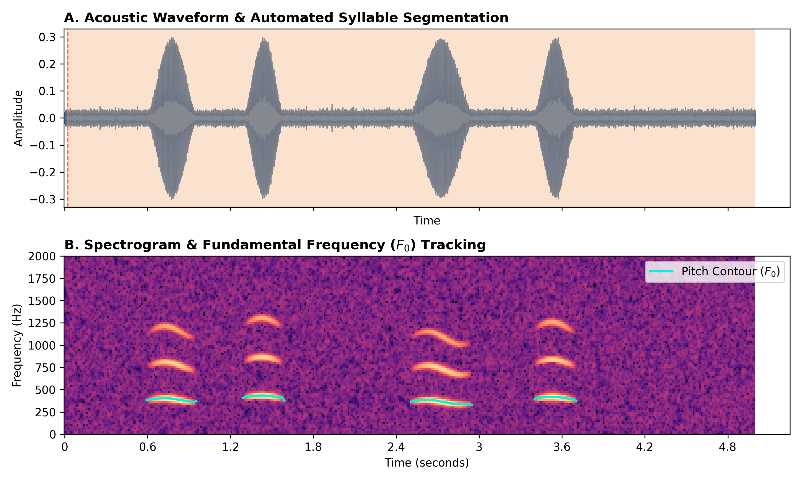

# Automated Vocalization Segmentation & Acoustic Rhythm Analysis

An open-source Python pipeline for automated syllable segmentation, fundamental frequency ($F_0$) extraction, and temporal rhythm analysis (inter-syllable intervals) in naturalistic vocal bouts.

## Overview
Quantifying the emergence of vocal communication requires measuring both spectral characteristics (pitch contours, harmonic structure) and temporal pacing (syllable duration, inter-syllable intervals). This repository provides an end-to-end, reproducible workflow for segmenting and analyzing acoustic time-series data without manual frame-by-frame annotation.

## Methods & Pipeline
1. **Synthetic Acoustic Data Generation:** Generates a multi-syllable vocal bout with realistic $F_0$ modulation, harmonic overtones, and ambient room noise to ensure full reproducibility without exposing protected human-subjects recordings.
2. **Automated Syllable Segmentation:** Identifies vocal onsets and offsets using root-mean-square (RMS) energy thresholding (`librosa.effects.split`) and minimum duration filtering ($>80\text{ ms}$).
3. **Pitch ($F_0$) & Rhythm Extraction:** Tracks fundamental frequency contours via probabilistic YIN (`librosa.pyin`) and computes syllable durations and onset-to-onset inter-syllable intervals (ISIs).

## Interactive Demo
Click the **Open in Colab** badge at the top of this page to run the full signal processing pipeline and reproduce the figure directly in your browser.
